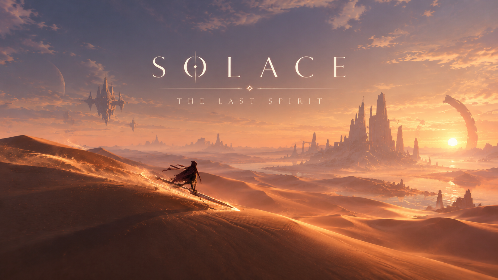
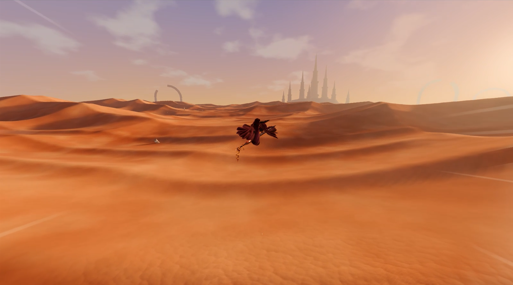
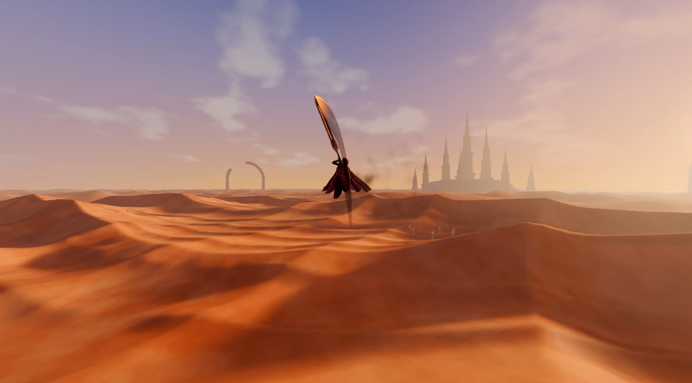
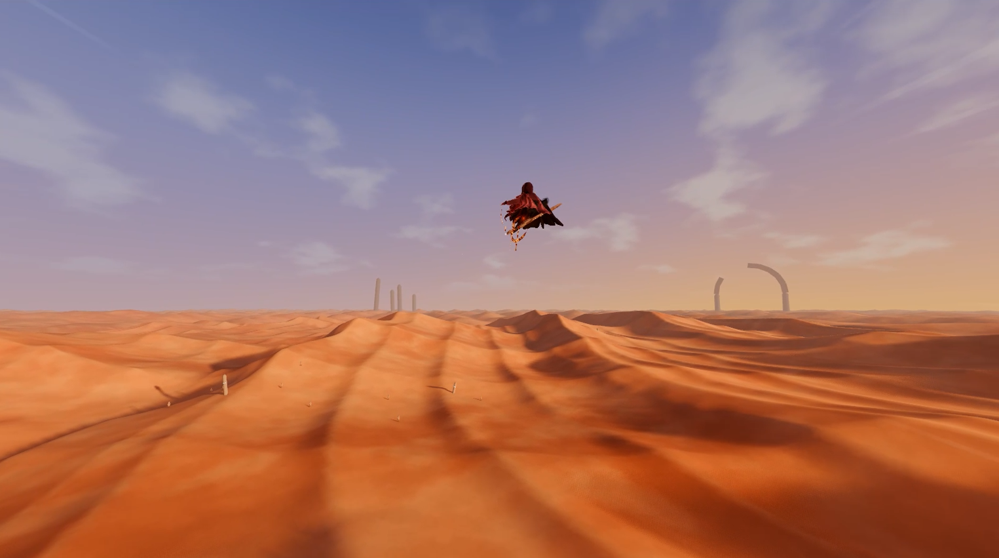
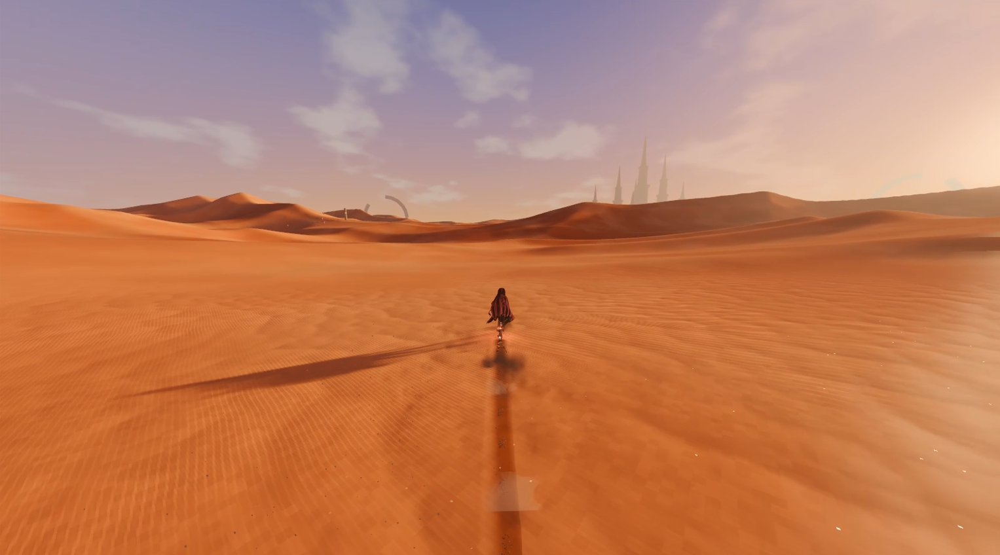

# Solace: The Last Spirit



## Gameplay






Godot 4.7 · Forward+ · GDScript. Abra o projeto e rode `scenes/main/main.tscn` (é a cena principal, F5).

## Controles
| Ação | Teclado/mouse | Controle |
|---|---|---|
| Correr (a pé, relativo à câmera) | WASD | analógico esquerdo |
| Prancha: entalhar / impulsionar / frear | A·D / W / S (relativo à prancha) | analógico esquerdo |
| Andar | segurar Alt | analógico pela metade |
| Câmera / zoom | mouse / roda | analógico direito |
| Sprint (a pé) · Boost (prancha) | Shift | RB |
| Pular | Espaço (a pé: segurar = mais alto; prancha: segurar para carregar, soltar para saltar) | A |
| Giros no ar (prancha) | A·D no ar — aterrisse alinhado para ganhar velocidade | analógico |
| Dash (cancela em pulo; 1× no ar) | Ctrl ou botão direito | B |
| Invocar / dispensar prancha | Q | Y |
| Pausa (libera o mouse) | Esc | Start |
| Voltar ao início | R | — |
| Dica de controles / debug / tela cheia | F1 / F3 / F11 | — |

## Onde ajustar a sensação (todos são `@export`, editáveis no Inspector)
- **A pé** — `Player/FootMotor` (`scripts/player/foot_motor.gd`): andar/correr/sprint, giro com momento, pulo, dash.
- **Prancha** — `Player/HoverMotor` (`scripts/hoverboard/hover_motor.gd`): altura do hover, mola/amortecimento, velocidade de cruzeiro, boost, curva, aderência, ganho em declive, pulo.
- **Pose da prancha / postura** — `Player/Visual` (`scripts/player/player_visual.gd`): inclinação nas curvas, alinhamento ao terreno.
- **Corpo** — malha orgânica única gerada por campo de distância (`scripts/player/spirit_body_builder.gd`), em cache em `assets/spirit/spirit_body.res`. Depois de mudar proporções, regenere:
  `Godot --headless --path . --script res://scripts/tools/build_spirit_mesh.gd`
- **Animação** — `Player/Visual/SpiritModel` (`scripts/player/spirit_model.gd`): locomoção por **captura de movimento** (CMU, retarget em `assets/mocap/*.res`), velocidades de cada marcha, expoente de cadência, inclinação estilizada, travamento de pé. Reimportar: `Godot --headless --path . --script res://scripts/tools/import_mocap.gd`
- **Variações contextuais** — `Player/Visual/MotionContext` (`scripts/player/motion_context.gd`): limiares, cooldowns e chances do toque na areia, aterrissagem baixa, parada brusca, olhar para o horizonte, gestos ociosos, sentar (20–35 s), agarrar a prancha no ar e deslize relaxado.
- **Fitas** — `Player/Visual/Ribbons` (`scripts/effects/ribbons.gd`): duas fitas dirigidas (fluxo com atraso ao longo do comprimento + onda), material em `materials/scarf.tres`.
- **Surf** — `Player/HoverMotor`: grupos *Hover* (altura rente à areia), *Ride* (momento, ganho em declive), *Drift*, *Air* (pulo carregado) e *Air tricks* (giros, tolerância de aterrissagem, assistência).
- **Dunas** — `crest_sharpness` em `Desert/DuneTerrain` controla a crista afiada.
- **Efeitos** — `particle_intensity` em `PlayerFX` e `Hoverboard`.
- **Câmera** — `CameraRig` (`scripts/camera/follow_camera.gd`): sensibilidade, distância, suavização (molas criticamente amortecidas), FOV, alinhamento automático.
- **Dunas** — `Desert/DuneTerrain` (`scripts/environment/dune_terrain.gd`): seed, altura, comprimento de onda, vento.
- **Luz / atmosfera** — `Desert/Sun` (azimute/elevação) e `Desert/WorldEnvironment`; céu em `shaders/sky.gdshader`, areia em `materials/sand.tres`.
- **Áudio** — `Audio` (`scripts/audio/ambient_audio.gd`): sintetizado em tempo real, sem arquivos. Para usar sons gravados, troque os `stream` criados ali.

## Validação automática
```
Godot --headless --path . --fixed-fps 60 -- --autotest     # teste de gameplay (PASS/FAIL), inclui deslize dos pés, variações e repouso
Godot --path . -- --tour --out=<pasta>                     # tour com screenshots
```
